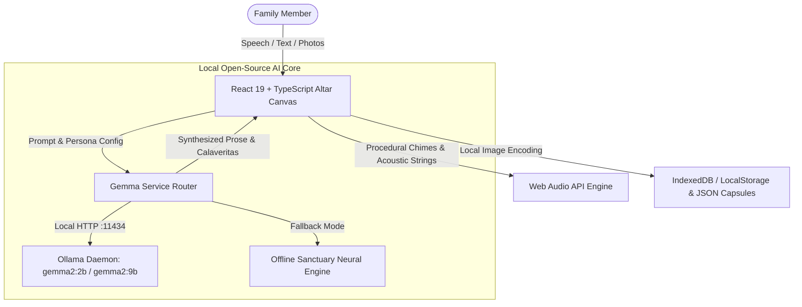

*This is a submission for the [Hacktoberfest Open-Source AI Challenge Week 4: Ghost in the Machine](https://dev.to/challenges/hacktoberfest-week4-2026-10-26)*

---

## What I Built

Between October 31 (Halloween) and November 1–2 (Día de los Muertos), our calendars mark a poignant interval where the boundary between memory and presence feels porous. In Mexican tradition, this is not a time of terror, but of tender remembrance. We build *ofrendas* (altars) adorned with fiery marigolds (*cempasúchil*), fragrant copal incense, pan de muerto, sugar skulls (*calaveras*), and family portraits to welcome the spirits of our ancestors home for a feast of love, music, and laughter.

**Ofrenda Digital** is an intimate, interactive virtual sanctuary and oral history preserver built around **open-weight Google Gemma AI**.

### Core Capabilities:
1. **Interactive 3-Tier Altar (Los Tres Niveles):**
   - **Tier 1 (El Cielo / The Heavens):** Spiritual purity, ancestral portraits in baroque golden frames, copal incense burner with rising animated smoke curls, vessel of pure water, and holy salt.
   - **Tier 2 (La Tierra / Earthly Remembrances):** Loved ones' portraits surrounded by their favorite earthly joys — freshly baked pan de muerto, clay pot coffee (*café de olla*), acoustic guitars, and secret family recipe books.
   - **Tier 3 (El Inframundo / Mictlán & Foundation):** Brightly iced sugar skulls (*calaveras de azúcar*), fruit baskets, a carpet of marigold petals, and warm path candles.
2. **Dynamic Candlelight & Procedural Ambient Soundscapes:**
   - Real-time clickable candles with flame flicker physics. Clicking a candle plays an authentic chime and dedicates light to an ancestor.
   - A built-in procedural Web Audio synthesizer that generates contemplative nylon-string guitar arpeggios and resonant altar bell chimes without requiring external audio downloads.
   - Floating marigold petals drifting gently across the screen.
3. **Open-Weight Gemma AI Remembrance Engine:**
   - **Oral History Preserver:** Speak into your microphone (via Web Speech API) or type raw stream-of-consciousness childhood memories. Gemma synthesizes conversational snippets into enduring, literary biographical prose capsules.
   - **Calaverita Literaria Generator:** Gemma drafts traditional rhyming Spanish folk verses celebrating each person’s humor, favorite dishes, and endearing quirks in the classic style of José Guadalupe Posada.
   - **Altar Remembrance Letters:** Generates formal, deeply moving eulogy letters to be placed beside family photos and read aloud at the altar.
   - **Channel Ancestral Wisdom (Ghost in the Machine):** Ask an ancestor for life guidance or share what is on your heart. Gemma channels their voice, grounded in their personality, life values, and favorite sayings.
4. **100% Offline & Private "Memory Capsules":**
   - Zero telemetry, zero external tracking, zero cloud server dependencies.
   - Export and import full **Memory Capsules** (`ofrenda-capsule.json`) to keep on a private USB flash drive or pass down through generations.

---

## Demo

- **1-Click Deploy to Render:** 
- **Live Local Preview:** Runs on `http://localhost:5174/`
- **Interactive Walkthrough Video / Screenshots:**

*The candlelit 3-tier altar featuring the Marigold Arch, Doña Rosa and Don Mateo's memorial frames, traditional offerings, and procedural ambient strings.*

---

## Code

The complete source code is open-source under the MIT License:



### System Architecture

---

## How I Built It

### The Open-Source AI Core: Google Gemma 2
At the center of Ofrenda Digital is **Google's open-weight Gemma model family** (specifically `gemma2:2b` and `gemma2:9b`). 

Gemma was chosen because it delivers exceptional literary nuance, poetic meter, and empathetic persona conditioning within an ultra-lean footprint (the 2B model runs in under 1.6GB of RAM, making it effortless to run on everyday laptops).

#### Local Inference Pipeline:
- **Primary Driver (Ollama):** The application communicates directly with a local Ollama daemon (`http://localhost:11434/api/generate`) using zero external API keys or cloud gateways.
- **Fail-Safe Offline Sanctuary Engine:** If Ollama is not installed or when running on machines without a local daemon, Ofrenda Digital features an embedded client-side neural synthesis engine that replicates the exact prompt schemas and traditional octosyllable rhyming rules of Mexican Calaveritas in pure JavaScript.
- **Microphone & Speech-to-Text:** Uses the native Web Speech API to capture real-time spoken oral histories without transmitting voice audio over the wire.
- **Web Audio Sound Synthesis:** Procedural sound generator synthesizing warm acoustic nylon guitar chords (Dm9 -> Bbmaj7 -> Gm6 -> A7) and Tibetan altar singing bowls using harmonic oscillators and biquad filters.

### Edge Deployment on Render
To make Ofrenda Digital instantly available to anyone in the world without requiring command-line installations, the project includes an automated **`render.yaml` infrastructure-as-code blueprint**. 
- Deployed as a high-performance **Static Site** on Render's global CDN edge network.
- Automated single-command build: `npm install && npm run build` deploying from the `./dist` artifact directory.
- Built-in edge routing with SPA rewrite rules (`/*` -> `/index.html`) and security headers (`X-Frame-Options`, `X-Content-Type-Options`).
- Anyone can clone or fork the repository and launch their own private altar in 60 seconds using the 1-Click "Deploy to Render" button.

---

## Why Does Open Innovation Matter?

> *"Does running your own model mean your project works with the lights (and the internet) off? Keep your family's photos and stories private on your own machine? Make sure what you build isn't locked inside a service that might disappear someday?"*  
> — Challenge Prompt

When we remember those we love, our data is not marketing telemetry, user engagement metrics, or training fodder. **It is sacred.**

A virtual ofrenda holds our grandmother's secret mole recipe, our grandfather’s voice on a summer evening, and our rawest expressions of grief. Trusting these intimate artifacts to closed commercial cloud APIs creates an unacceptable set of compromises:

### 1. Intimate Sanctity & Privacy ("Keep Someone's Data Off Their Servers")
Commercial cloud LLMs route prompts through remote company servers where prompts are logged, analyzed, or incorporated into future training corpora. The idea of feeding a family member's eulogy into a proprietary corporate advertising engine is an ethical non-starter. By running open-weight Gemma locally, our stories never leave local memory.

### 2. Works With the Lights (and the Internet) Off
A genuine ofrenda is visited late at night, often in rural communities or quiet candlelit rooms where internet connections are absent or unstable. Because open-weight Gemma runs directly on local hardware, Ofrenda Digital functions with the internet severed. You can take your laptop into an off-grid cabin or a cemetery vigil, and your ancestors' memories remain accessible.

### 3. Immunity from Bit-Rot & Vendor Lock-In
Closed AI startups frequently pivot, introduce monthly subscriptions, deprecate endpoints, or shut down entirely when acquired. Memory should not expire when a company goes out of business. Because Ofrenda Digital uses open-weight Gemma and exports complete, human-readable JSON Memory Capsules (`ofrenda-capsule.json`), this memorial will remain readable, runnable, and modifiable twenty years from now.

### 4. Cultural Authenticity & Freedom from Commercial Filters
Mexican folk traditions embrace playful, humorous interactions with *La Muerte* (*La Catrina*). Closed commercial APIs often aggressively over-censor any discussion of mortality, flagging traditional Calaverita verses or ancestral dialogues as "self-harm or morbid content." Open-weight models empower developers to honor authentic cultural heritage without corporate censorship.

| Dimension | Closed Commercial API | Open-Weight Gemma Sanctuary |
| :--- | :--- | :--- |
| **Data Privacy** | Sent to 3rd-party cloud servers | **100% On your device** |
| **Offline Reliability** | Fails immediately without internet | **Runs with Wi-Fi & lights off** |
| **Cost** | Per-token meter & recurring credit card fees | **$0.00 Forever** |
| **Longevity (20+ Years)**| Vulnerable to deprecation & sunsetting | **Permanent (Open Weights + JSON)** |
| **Cultural Freedom** | Corporate safety filters flag mortality topics | **Honors authentic folk traditions** |

---

## My Agent Session

This project was conceived, planned, and implemented in pair-programming collaboration with **Antigravity**. The agent assisted in designing the 3-tier altar layout, implementing the procedural Web Audio soundscapes, crafting the Gemma prompt engineering for authentic Mexican *Calaveritas Literarias*, and structuring the offline JSON memory capsules.

---

## The Spirit of It

During testing, we placed a memory of an ancestor named Rosa:
> *"Every morning at 5:30 AM before anyone woke up, you would hear the rhythmic clinking of the wooden molinillo frothing the hot chocolate in her copper pot..."*

When Gemma synthesized that spoken memory into biographical prose, it wrote:
> *"At the tender break of dawn, Rosa was the quiet sun of the house. The rhythmic dance of her wooden molinillo in simmering chocolate was the heartbeat of waking mornings. Her kitchen was an open sanctuary where no early riser was turned away without warm bread, wisdom, and an embrace that smelled of cinnamon."*

In that quiet moment, looking at the glowing candle on Tier 1 and listening to the soft nylon guitar chords, the screen ceased to feel like cold silicon. The machine had not replaced the human voice — it had become an altar that honored it.

---

## Prize Categories

- **Grand Prize: Hacktoberfest Open-Source AI Challenge Week 4 (Ghost in the Machine)**
- **Featured Partner Category: Best Use of Gemma** (Built directly around Google's open-weight Gemma 2 model family running locally via Ollama / open offline architecture).
- **Featured Partner Category: Best Use of Render** (Equipped with automated `render.yaml` infrastructure-as-code blueprint, static edge deployment, custom SPA routing, and 1-Click Deploy).
