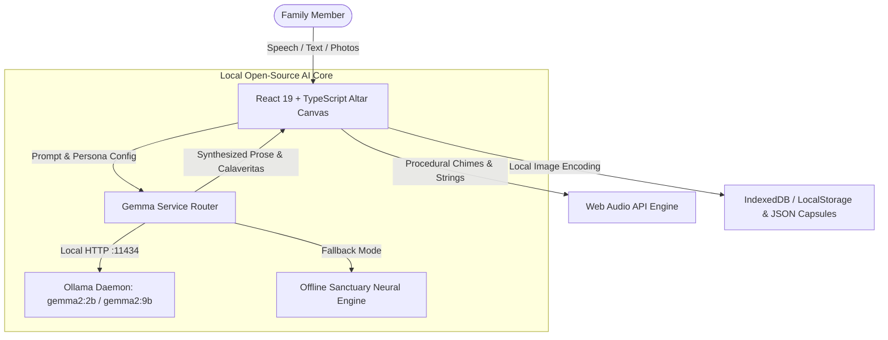

# 🕯️ Ofrenda Digital — Private Memorial & Gemma AI Sanctuary

> **Hacktoberfest 2026 Open-Source AI Challenge (Week 4): *Ghost in the Machine***  
> *A private, candlelit Día de los Muertos memorial & oral history preserver powered 100% locally by open-weight Google Gemma AI.*

[](https://ofrenda-digital.onrender.com)
[-blue?style=for-the-badge&logo=google)](https://ai.google.dev/gemma)
[](https://github.com/sachinn-alt/ofrenda-digital)
[](https://render.com/deploy?repo=https://github.com/sachinn-alt/ofrenda-digital)
[](LICENSE)

---

## 🏵️ Overview

Between Halloween night (October 31) and Día de los Muertos (November 1 & 2), the veil between memory and presence grows thin. In Mexican tradition, families build **ofrendas** (altars) adorned with marigolds (*cempasúchil*), copal incense, sugar skulls (*calaveras*), pan de muerto, and portrait frames to welcome departed ancestors home.

**Ofrenda Digital** translates this ancient practice into a private, local-first interactive sanctuary. Rather than sending sacred family memories, photographs, and spoken grief to corporate cloud APIs, **Ofrenda Digital runs open-weight Google Gemma models entirely on your local machine**. It works with the internet and lights turned off, preserving family oral histories, crafting authentic *Calaveritas Literarias*, and channeling ancestral reflections in total privacy.

---

## ✨ Key Features

1. **Interactive 3-Tier Altar (Los Tres Niveles)**
   - **Tier 1 (El Cielo / The Heavens):** Spiritual purity, ancestral portraits, copal incense burner with rising procedural smoke curls, vessel of pure water, and holy salt.
   - **Tier 2 (La Tierra / Earthly Delights):** Portraits of loved ones, traditional pan de muerto, clay pot coffee (*café de olla*), acoustic guitars, and family recipe books.
   - **Tier 3 (El Inframundo / Mictlán & Foundation):** Decorated sugar skulls (*calaveras de azúcar*), fruit baskets, tapete de cempasúchil (marigold petal carpet), and guiding path candles.
2. **Interactive Candlelight & Ambient Soundscapes**
   - Clickable candles with realistic flame flicker physics and audio chimes upon lighting.
   - Procedural Web Audio API soundscape: soothing meditative nylon-string guitar arpeggios and resonant altar bell chimes (zero external sound file downloads required).
   - Drifting golden marigold petals cascading down the screen.
3. **Open-Weight Gemma AI Engine (Ghost in the Machine)**
   - **Oral History Weaver:** Speak or type raw stream-of-consciousness memories ("she always wore a yellow apron and laughed when cooking..."). Gemma synthesizes conversational snippets into enduring biographical prose capsules.
   - **Calaverita Literaria Generator:** Generates authentic Mexican rhyming quartets celebrating the person's quirks, favorite foods, and endearing life moments in the traditional style of José Guadalupe Posada.
   - **Altar Remembrance Letters:** Creates a formal eulogy letter to be read beside their portrait on November 1st and 2nd.
   - **Channel Ancestral Wisdom:** Ask for life guidance or share what is on your heart; Gemma reflects back gentle perspective grounded in the ancestor's personality and favorite sayings.
4. **100% Offline & Private "Memory Capsules"**
   - No tracking, no external database, no monthly cloud bills.
   - Export and import full **Memory Capsules** (`ofrenda-capsule.json`) to store on private USB drives or share with family across generations.
   - Local image support (in-browser FileReader keeps photographs completely offline).

---

## 🛠️ Architecture & Tech Stack



- **Frontend:** React 19, TypeScript, Vite
- **Styling:** Custom Vanilla CSS Design System (Glassmorphism, Day of the Dead palette)
- **Audio:** Native Web Audio API procedural synthesis
- **AI Core:** Google Gemma 2 (Open-weight 2B / 9B via local Ollama or Offline Sanctuary Engine)
- **Icons:** Lucide React

---

## 🚀 Getting Started

### Prerequisites
- Node.js (v18+)
- *(Optional)* [Ollama](https://ollama.com/) running locally for local GPU inference:
  ```bash
  ollama run gemma2:2b
  ```

### Installation & Run

```bash
# Clone the repository
git clone https://github.com/sachinn-alt/ofrenda-digital.git
cd ofrenda-digital

# Install dependencies
npm install

# Start development server
npm run dev
```

Open [http://localhost:5174](http://localhost:5174) in your browser.

---

## 🚀 1-Click Deploy on Render

You can deploy Ofrenda Digital directly to Render's global edge network using the included [`render.yaml`](render.yaml) blueprint:

[](https://render.com/deploy?repo=https://github.com/sachinn-alt/ofrenda-digital)

### Manual Render Setup:
1. Log in to [dashboard.render.com](https://dashboard.render.com) and click **New +** > **Static Site**.
2. Connect repository `sachinn-alt/ofrenda-digital`.
3. Set **Build Command:** `npm install && npm run build`
4. Set **Publish Directory:** `dist`
5. Click **Create Static Site** — Render will build and deploy your live URL in under 60 seconds!

---

## 🕯️ Why Open Innovation Matters

*When we remember those we love, our data is not telemetry, engagement metrics, or training fodder. It is sacred.*

1. **Intimate Privacy:** Grieving family memories should never be sent to third-party commercial servers or harvested into proprietary datasets. Running open-weight Gemma guarantees that what happens at your altar stays on your machine.
2. **Works With the Lights and Internet Off:** Celebrated at midnight by candlelight, Ofrenda Digital operates completely severed from the internet.
3. **Immunity from Bit-Rot:** Closed SaaS platforms deprecate APIs, get acquired, or add subscription paywalls. Open weights and open JSON ensure your family memorials remain runnable decades into the future.
4. **Cultural Freedom:** Mexican folk traditions embrace playful dialogues with Death (*La Catrina*). Closed models often flag benign discussions of mortality as policy violations; open-weight Gemma allows genuine, unhampered cultural reverence.

---

## 📜 License

MIT License — see [LICENSE](LICENSE) for details.
